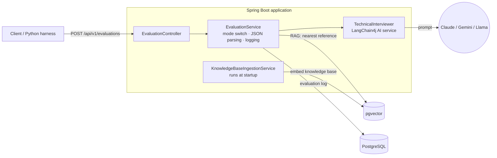

# MockBean

*An LLM-as-a-judge API that grades Java interview answers - and an experiment measuring whether it can be trusted.*

| | |
|---|---|
| **Results** | [Benchmark results](#results) - 3 models × 2 modes on 40 hand-labelled answers |
| **Report** | [raport/raport.pdf](raport/raport.pdf) (Polish) - method, statistics and conclusions |
| **API docs** | Swagger UI at `http://localhost:8080/swagger-ui.html` once running |

> Originally built as a research project for the *Computational Intelligence* course: can an LLM grade
> technical interview answers as reliably as a recruiter?

## Overview

You send a question and a candidate's answer; the API returns a structured verdict - a 0.0-1.0 score,
strengths, missed concepts and feedback - and logs it for analysis.

The interesting part is the experiment around it. The same service grades through three different
models and two strategies, so they can be compared on identical inputs:

- **Models** - Claude Sonnet 4.6, Gemini 2.5 Flash, or Llama 3.1 8B running locally - switched by Spring
  profile, with no change to business logic.
- **Modes** - **RAG** (retrieve a reference answer from pgvector and grade against it) or **Pure** (the
  model grades from its own knowledge) - chosen per request.

## Results

40 answers, hand-labelled into five classes (correct, partial, wrong, *waffle*, *evasive* - 8 each), two
runs per configuration, 95% bootstrap confidence intervals (10,000 resamples).

| Configuration | Accuracy | 95% CI | Notes |
|---|---|---|---|
| **Claude · Pure** | **92.5%** | 82.5-100% | identical verdicts across both runs |
| Claude · RAG | 82.5% | 70-92.5% | |
| Gemini · Pure | 87.5% | 77.5-97.5% | runs differed by 5 pp even at temperature 0 |
| Gemini · RAG | 80.0% | 67.5-92.5% | |
| Llama 3.1 8B · Pure | 57.5% | 42.5-72.5% | leniency bias: rewards wrong answers |
| Llama 3.1 8B · RAG | 50.0% | 35-65% | |
| Cosine-similarity baseline | 60.0% | | no LLM at all |

**Takeaways**

- Large hosted models are capable judges; the 8B local model is worse than a simple embedding baseline.
- **RAG did not improve accuracy for any model** in the original study. With n = 40 the intervals overlap,
  so this is "no gain", not proof of harm. A follow-up (below) found two causes: a chunking bug, and
  references shifting the score scale.
- Mean latency per verdict: ~6-7.5 s on the hosted APIs, ~23-26 s for Llama on CPU.

### Follow-up: the chunking bug behind RAG's weak results

RAG underperformed, so I inspected what the judge actually received. The knowledge base had been split
into 300-character chunks, and 46 of its 50 question-and-answer pairs are longer than that. For **38 of 50
questions, the chunk containing the question held no answer at all** - and because retrieval searches by
the question, that bare question was the most likely match. Embedding the test set confirmed it: for
**13 of the 20 distinct test questions**, the top-1 chunk was a question with no answer.

The fix keeps every pair whole (one chunk = one question with its full answer), adds a minimum relevance
of 0.80 with a fallback to Pure mode, and records the exact reference the judge saw. After it, all 20 test
questions retrieve their matching pair (relevance 0.83-0.92).

| Model · mode | Accuracy, 2 runs (fixed thresholds) | 95% CI (run 1) |
|---|---|---|
| Llama 3.1 · RAG, old 300-char chunks | 50.0% / 50.0% | 35-65% |
| Llama 3.1 · **RAG, Q&A-pair chunks** | **55.0% / 55.0%** | 40-70% |
| Llama 3.1 · Pure (same-day control) | 57.5% | 42.5-72.5% |
| Claude · RAG, old 300-char chunks | 82.5% / 82.5% | 70-92.5% |
| Claude · **RAG, Q&A-pair chunks** | **77.5% / 77.5%** | 65-90% |
| Claude · Pure | 92.5% / 92.5% | 82.5-100% |

The Llama same-day Pure control reproduced the original 57.5% exactly, so its change is attributable to the
fix. At the study's fixed thresholds the fix moved the two models in opposite directions (Llama +5 points,
Claude -5 points), both well inside the confidence intervals - so **better retrieval alone did not make RAG
beat Pure**. Gemini 2.5 Flash could not be re-run: Google no longer offers it to new projects.

> **What "calibration" means here.** A judge has two separate qualities. **Ranking** is whether it orders
> answers correctly (correct > partial > wrong). **Calibration** is whether a given score means the same
> thing everywhere - whether 0.70 is equally good in Pure and RAG mode. Think of two teachers who rank
> the same essays identically, but one gives the best essay 70/100 and the other 90/100: a single "85+ is
> an A" rule would be wrong for one of them, even though both judge equally well. The harness turns
> scores into verdicts with fixed thresholds (>= 0.65 correct, >= 0.30 partial), so a judge whose scale
> shifts gets misfiled answers without becoming a worse judge.

**What the misgraded answers show: RAG is a calibration problem.** Inspecting Claude's new errors, a complete
reference makes the judge *more lenient*: partial answers that share wording with the reference
("both inherit from `Throwable`") score 0.70-0.85 instead of ~0.50, and the fixed thresholds (tuned around
Pure mode) then file them as correct. The mean score for partial answers rises from 0.46 (Pure) to 0.62 (RAG).

| Model · mode | Fixed thresholds (0.65 / 0.30) | Best thresholds on this set |
|---|---|---|
| Claude · Pure | 92.5% | 92.5% |
| Claude · RAG, Q&A pairs | 77.5% | 92.5% (0.90 / 0.35) |
| Llama 3.1 · Pure | 57.5% | 75.0% (0.65 / 0.45) |
| Llama 3.1 · RAG, Q&A pairs | 55.0% | 82.5% (0.65 / 0.45) |

With thresholds fitted per mode, Claude separates the answer classes equally well with or without RAG, and
Llama separates them *better* with RAG. These best-threshold figures are tuned on the same 40 cases, so they
are optimistic - they show the scores need per-model, per-mode calibration on a held-out set, not a fair
accuracy. Full report: [results/v2-qa-chunking/comparison.md](results/v2-qa-chunking/comparison.md).

## Tech Stack

| Technology | Why it's here |
|---|---|
| **Java 21 & Spring Boot 3.5** | REST API, profiles for model selection, a clean service layer. |
| **LangChain4j** | Declarative AI service (an interface turned into a proxy) and a vendor-neutral `ChatLanguageModel`. |
| **PostgreSQL + pgvector** | Stores reference-answer embeddings for RAG retrieval, and the evaluation log. |
| **Ollama (`nomic-embed-text`, `llama3.1`)** | Free local embeddings for every profile; Llama as the local judge. |
| **Anthropic & Gemini APIs** | Hosted judges; Gemini runs through its OpenAI-compatible endpoint, so it needs no extra dependency. |
| **Flyway** | Versioned schema, including the pgvector extension and embeddings table; Hibernate only validates. |
| **Python (scikit-learn, NumPy, matplotlib)** | Evaluation harness, cosine baseline, bootstrap confidence intervals and charts. |
| **Docker Compose** | One-command PostgreSQL with pgvector. |
| **Testcontainers** | Spins up a real pgvector PostgreSQL for tests. |

## Architecture



**The flow**

1. The controller receives `{question, userAnswer, mode}`.
2. In **RAG** mode the service embeds the *question* and fetches the nearest question-and-answer pair
   from pgvector. If its relevance is below `mockbean.rag-min-score` (0.80), it falls back to Pure mode
   rather than grading against an unrelated reference. In **Pure** mode retrieval is skipped.
3. `TechnicalInterviewer` (a LangChain4j proxy with system and user prompt templates) calls whichever
   model the active profile made `@Primary`.
4. The raw reply is cleaned and parsed into a typed `EvaluationResponse`, saved as an `EvaluationLog`
   together with the judge model, requested and effective mode, retrieval score, the exact reference and
   the raw reply - and returned with the same audit fields.

## Engineering Decisions

- **Model choice is configuration, not code.** One small config class per provider, gated by `@Profile`,
  marks its `ChatLanguageModel` as `@Primary`. The service depends only on abstractions, so adding a model
  means adding a config class and a YAML file.
- **Mode is a request field, not a profile.** RAG and Pure can be compared against the same running model
  in the same experiment.
- **Structured output from a non-deterministic model.** Temperature 0, Ollama's JSON mode, a strict
  schema in the system prompt, and a defensive parser that strips code fences and extracts the JSON
  object. An unparseable reply becomes a `502`, an unreachable LLM or database a `503`.
- **One chunk per question-and-answer pair.** A reference is always a complete answer; the knowledge base
  is rebuilt from the file on every start, so restarts never duplicate vectors.
- **Every verdict is auditable.** The log stores which model judged, which mode actually ran, and the
  exact reference shown - which is how the chunking bug was found and verified.
- **Embeddings stay local.** Every profile embeds with `nomic-embed-text` on Ollama, so retrieval is free
  and identical across models - only the judge changes.
- **Measured, not assumed.** Two runs per configuration, adversarial *waffle* and *evasive* answers,
  confidence intervals, a threshold-sensitivity check and a non-LLM baseline - so "RAG helps" could be
  tested rather than believed.
- **Migrations over auto-DDL.** Flyway owns the schema; Hibernate runs with `ddl-auto: validate`.

## Testing

```bash
./mvnw test   # Testcontainers starts its own pgvector PostgreSQL
```

11 tests, no Ollama or API keys needed:

- **`KnowledgeBaseParserTest`** - every pair stays whole, topic headers never leak into a chunk, and the
  real knowledge base yields one complete segment per question.
- **`EvaluationServiceTest`** - RAG with a relevant reference, fallback to Pure below the minimum score,
  Pure skipping retrieval, the audit fields saved, and fenced JSON from the model still parsed.
- **`PgVectorRetrievalIntegrationTest`** - real pgvector (Testcontainers): the nearest pair is returned
  above the threshold, and an unrelated query returns nothing.
- **`MockBeanApplicationTests`** - the context starts and Flyway migrates a real pgvector database.

The research results come from the Python harness, not the unit tests:

```bash
pip install -r scripts/requirements.txt
python scripts/run_evaluation.py --model gemini-flash --mode rag   # see --help for all options
python scripts/bootstrap_analysis.py
python scripts/baseline_cosine.py
python scripts/compare_chunking.py --save                          # old vs new chunking
```

## Trade-offs and Known Limitations

- **One score scale for every mode.** RAG shifts scores upward, so fixed thresholds under-rate it. A real
  deployment would calibrate thresholds per model and mode on a held-out set, or prompt the judge to grade
  concepts rather than overlap with the reference.
- **Gemini 2.5 Flash is retired for new projects**, so its RAG result is from the original chunking only.
- **The relevance threshold is tuned on this test set.** 0.80 cleanly separates on-topic (>= 0.83) from off-topic
  (<= 0.76) questions here; a different knowledge base would need it re-measured.
- **No input validation.** The request has no `@Valid` / `@NotBlank`, so blank input reaches the LLM.
- **Synchronous LLM calls** hold a request thread for seconds. Production would need async jobs with a
  correlation id, timeouts and retries, and caching of identical evaluations.
- **Small, single-labeller dataset.** 40 cases labelled by the author, with no comparison to real
  recruiters - enough for directional conclusions, not statistical certainty.

## Running Locally

Requires Docker, Java 21 and [Ollama](https://ollama.com).

```bash
docker compose up -d                            # PostgreSQL + pgvector
ollama pull llama3.1 && ollama pull nomic-embed-text
./mvnw spring-boot:run                          # default: local Llama 3.1 judge
```

Hosted judges:

```bash
ANTHROPIC_API_KEY=... ./mvnw spring-boot:run -Dspring-boot.run.profiles=claude-sonnet-4-6
GOOGLE_API_KEY=...    ./mvnw spring-boot:run -Dspring-boot.run.profiles=gemini-flash
```

Example request:

```bash
curl -X POST http://localhost:8080/api/v1/evaluations \
  -H "Content-Type: application/json" \
  -d '{"question":"What is the difference between == and equals()?","userAnswer":"== compares references, equals compares values.","mode":"rag"}'
```

## License

MIT
